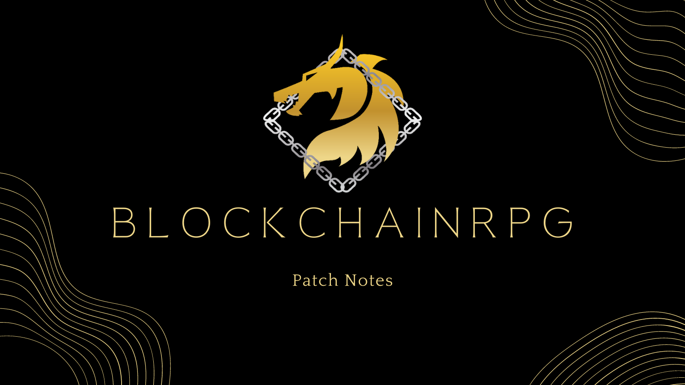

# October 2026 Update: Arena & Artifact Upgrades

Our October update (V6.1.0) brings **player-versus-player Arena battles** to the BlockchainRPG Dashboard, makes upgrading your equipped artifacts easier, and adds more choice when summoning bosses. Here's what's new since our last release.

<!-- truncate -->

## ⚔️ Introducing Arena: 2v2 Skirmish

Four players, two teams, one winning side.

- **Choose your fighters** and get matched with three other players. Each player contributes one character per match, and teams are assigned automatically. Your own characters will never face one another.
- **Battles resolve automatically** using your characters' attack, defense, and current health. Prepare your character before joining; its fighting stats are fixed when it enters the queue.
- **Follow your queue and match progress** from the Arena page, with clear updates while entries, refunds, and results are being confirmed.
- **Check your match history and stats**, including wins, losses, win rate, and GP results.

The queue prioritizes players who have been waiting longest. This first mode does not match players by level or strength, so choose your fighter carefully!

### More fighters, fewer clicks

- **Select up to 20 available characters** to join the queue together. Each character enters its own match; this doesn't create a premade team.
- **Review your fighters, total entry cost, and potential winnings** before confirming.
- **Cancel several waiting entries together**, with a preview of the GP you'll get back and clear refund progress.
- A more compact Arena layout makes it easier to follow your fighters on a phone.

### Entry fees and rewards

Each entry costs **1,000 staked GP**. A full match creates a **4,000 GP pot**:

- **400 GP is burned** — 10% of the pot.
- **Each winning player receives 1,800 GP** back into their staked balance. That includes their entry fee, for a net gain of 800 GP.
- Players on the losing team receive no GP payout and lose their entry fee.

You can **cancel while your entry is still waiting for a match and receive a full refund**. Once your entry is being matched, cancellation is no longer available. Refunds and winnings may take a little time to confirm.

### Look after your fighters

A queued character is unavailable for other activities until its cancellation or match results are confirmed. **Damage from Arena battles carries over** to your character afterward.

Surviving characters receive a **5-minute cooldown**. Knocked-out characters receive a **60-minute cooldown**. Check your health before heading into the next fight.

### Replay your battles

Open a match from your Arena history to see both teams and follow the action:

- Play or pause the replay, step through each duel, or jump straight to the final result.
- Track each character's remaining health and see who was knocked out.
- Expand the full battle log to revisit a specific duel.
- **Click a player's wallet name to visit their profile.**

Replay controls support keyboard navigation, and the team view adapts to phones and larger screens.

### A new daily quest

**Complete one Arena fight, win or lose, to earn one Rabbit Stew.**

Once your match's rewards and character results are confirmed, visit the **[Quests page](https://dash.blockchainrpg.io/quests)** to claim your stew. The quest resets at **midnight UTC**; a match counts toward the day its results are confirmed.

## ✨ Easier Artifact Upgrades

Getting your character ready for the next fight is simpler in the Dashboard:

- **Upgrade equipped artifacts directly from your character page**, without removing them first.
- See your **attack, defense, and health artifacts** in a refreshed loadout panel, then save equipment changes together.
- **Upgrade chances now correctly reflect the artifact's level and the Essence you spend**, with the displayed chance matching the game's calculation.
- Improved balance and inventory updates help your new artifact levels and remaining resources stay up to date. A slow refresh no longer hides a confirmed upgrade result.

Save any equipment changes before upgrading. Characters taking part in Arena need to finish or leave the queue before you can change their gear.

## 🐉 Choose Your Boss Fight

The Dashboard's summon screen now lets you choose between a **public boss** for everyone to fight and a **private boss** for your own battles.

Private summons cost **50% more materials**, and private bosses have **50% more health**. The summon screen shows the required amounts before you confirm. We've also fixed boss summoning and boss details so the selected boss is identified correctly.

## 🎨 More Reliable Artwork

Character portraits, artifacts, stickers, and Essence Chests should load more consistently. We've improved recovery for missing images and fixed artifact artwork that appeared with too much empty space around it.

## 🛠️ Fixes and Improvements

- Improved daily quest reward recovery when a connection drops or a claim is interrupted.
- Fixed daily quest resets so reward claims count toward the correct day.
- Improved wallet switching so account details and pending updates stay with the correct player.
- Improved recovery from interrupted connections, with more reliable GP and character updates after Arena battles.
- Fixed Dashboard loading errors and improved overall stability.

Ready to put your characters to the test? Open **[Arena in the Dashboard](https://dash.blockchainrpg.io/arena)**, choose **2v2 Skirmish**, and join the queue.

Thanks for playing, and see you in the Arena!
